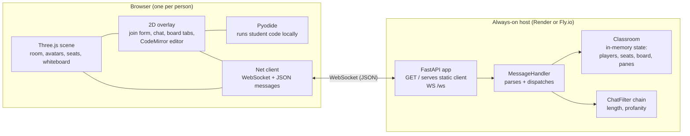
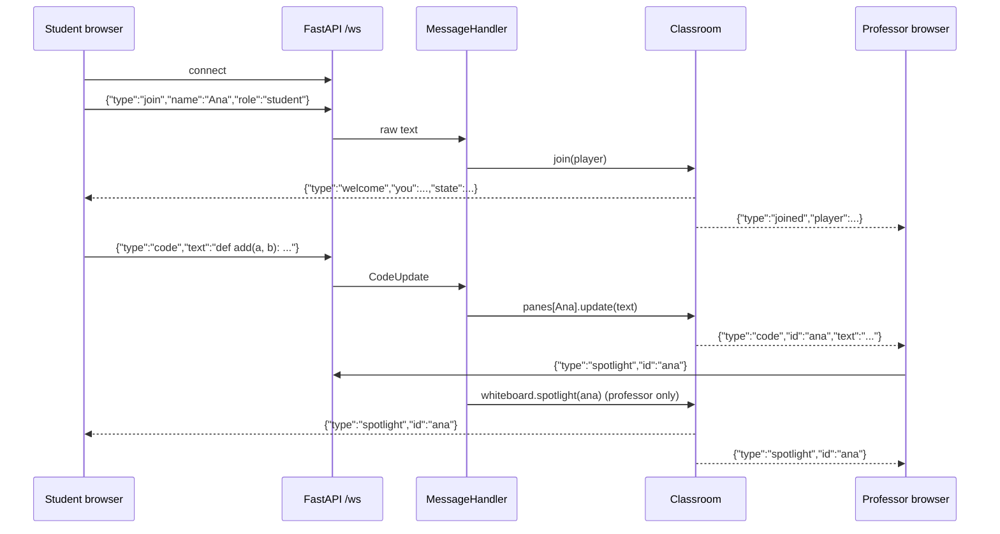

# PyCampus Classroom: system architecture (Python version)

This describes the planned Python version of the classroom. The demo that runs on Vercel today uses Supabase Realtime instead of a Python server (see the last section), but it keeps the same message types so the client can switch over later.

For the project overview and the full feature list, see [overview.md](overview.md). The class design is in [uml.md](uml.md).

## Components



Why a long-running host: the server keeps open WebSocket connections and live room state in memory. Serverless platforms such as Vercel end each request after a few seconds, so they can't do this. Render and Fly.io both run a normal `uvicorn` process.

Why code runs in the browser (Pyodide) and not on the server: running untrusted student code on the server would need sandboxing. In the browser, each person runs only their own code, so there's nothing to secure on the server.

## How a message flows

Every message is a small JSON object with a `type` field. The server is the single source of truth: it validates each message, updates the `Classroom`, then broadcasts the result.



## Rules the server enforces

| Rule | Where |
|---|---|
| At most 10 players; the 11th gets `{"type":"full"}` | `Classroom.join` |
| At most one professor; a second "professor" join is refused | `Classroom.join` / `RoleChange` |
| Professor leaves → slot frees, spotlight clears | `Classroom.leave` |
| Only the professor can post a problem or spotlight | `MessageHandler` checks `player.can_spotlight()` |
| A student can only edit their own pane | `CodeUpdate.apply` uses the sender's id |
| Chat ≤ 200 chars, filtered | `ChatFilter` chain |
| Code pane ≤ 10,000 chars | `CodePane.update` |
| One player per seat | `Seat.occupy` |

## Suggested project layout

```
server/
  main.py            FastAPI app, /ws endpoint, static files
  models/
    position.py      Position (value object)
    entity.py        Entity (abstract), Player, Professor, Student
    classroom.py     Room (abstract), Classroom, Seat
    board.py         Whiteboard, CodePane
  protocol/
    messages.py      Message (abstract) + subclasses, registry
    handler.py       MessageHandler
    filters.py       ChatFilter (abstract), LengthFilter, WordFilter
  tests/             pytest: join rules, professor slot, spotlight rules
client/
  index.html         Three.js scene + overlay (same as the demo)
```

## The demo version (Vercel + Supabase), for comparison

The demo skips the Python server. Each browser talks to a Supabase Realtime channel directly:

- **Presence** stores who is in the room (name, role, seat). The professor slot is whoever is the earliest-joined `professor` in presence.
- **Broadcast** carries the same message types as above (`move`, `chat`, `sit`, `hand`, `code`, `problem`, `spotlight`).
- Rules such as "only the professor can spotlight" are checked by each browser when it receives a message, not by a server. That's fine for a demo, but anyone could bypass them, which is one reason the Python server is the better long-term design.
