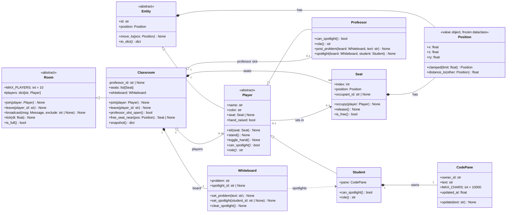
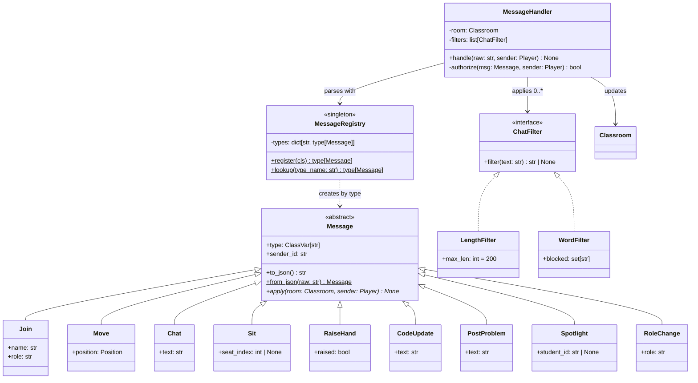
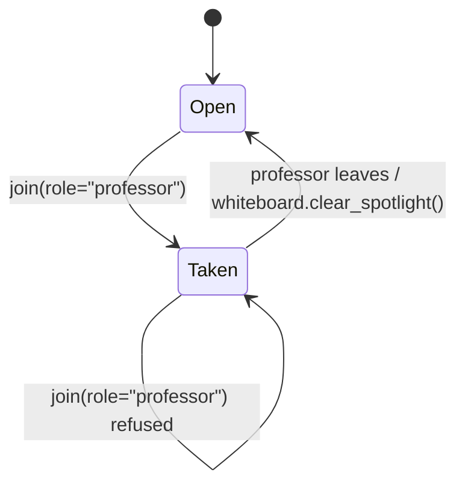

# PyCampus Classroom: UML class diagram (Python version)

These are the server-side classes for the planned FastAPI version (see [architecture.md](architecture.md)). The diagrams are split into the domain model and the message protocol so each one stays readable.

## 1. Domain model

**OOP ideas shown here**

- **Abstraction:** `Entity`, `Player` and `Room` are abstract base classes (`abc.ABC`). They can't be created directly.
- **Inheritance and polymorphism:** `Student` and `Professor` override `can_spotlight()` and `role()`. The handler calls `player.can_spotlight()` without checking the type.
- **Encapsulation:** `Classroom` keeps `professor_id` private and exposes `professor_slot_open()`. `CodePane.update()` enforces the size limit itself.
- **Composition vs aggregation:** a `Classroom` owns its seats and whiteboard (they're created and destroyed with it), but only references players, who come and go.
- **Value object:** `Position` is a frozen dataclass, so moving creates a new `Position` instead of changing one in place.

## 2. Message protocol

**How it fits together**

1. `MessageHandler.handle()` reads `type` from the JSON, asks `MessageRegistry.lookup()` for the class, and builds it with `from_json()`.
2. `authorize()` rejects messages the sender isn't allowed to send. For example, `Spotlight` and `PostProblem` need `sender.can_spotlight()`.
3. `Chat` text passes through each `ChatFilter` in order. A filter can shorten the text, or return `None` to drop the message.
4. `msg.apply(room, sender)` changes the state, and the room broadcasts the result with `to_json()`.

Each subclass registers itself with a decorator (`@MessageRegistry.register`). To add a new message type, you write one class and change nothing else, which shows the **open/closed principle**.

## 3. Lifecycle of the professor slot

